# Compass — Architecture

> Reflects the current code: the modularized backend (`main.py` reduced from ~12,300 lines to its permanent
> core, everything else in `backend/routers/`), the daily/weekly digest scheduler, and the research features
> built on SEC filings (Tear Sheet, Holdings Performance). See `CHANGELOG.md` for the build history,
> `README.md` for setup and the feature list, and `http://localhost:8000/docs` for the live API reference.

## System Overview

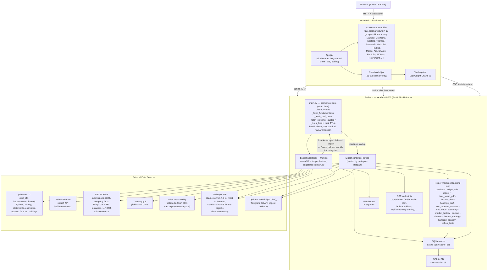

**Why the core is small:** `main.py` was a 12,269-line monolith as of mid-2026 and was extracted, section by section, into `backend/routers/` until only what's genuinely shared by nearly every router — the five `_fetch_*` helper functions and their TTLs, the health check, and the SPA catchall — remained. Extracting that core further would just move the "everything imports from here" problem to a different file, not remove it, so it's the intended floor for this architecture.

**Deferred imports:** because `main.py` imports every router module to register it (`app.include_router(...)`), a router importing something from `main.py` at module load time would create a circular import. The fix used throughout the codebase is a *function-scoped* deferred import — `from main import _fetch_perf_one` written inside the endpoint function body, not at the top of the file — which only resolves at request time, after both modules have finished loading.

## Data Flow — Live Price Feed (WebSocket)

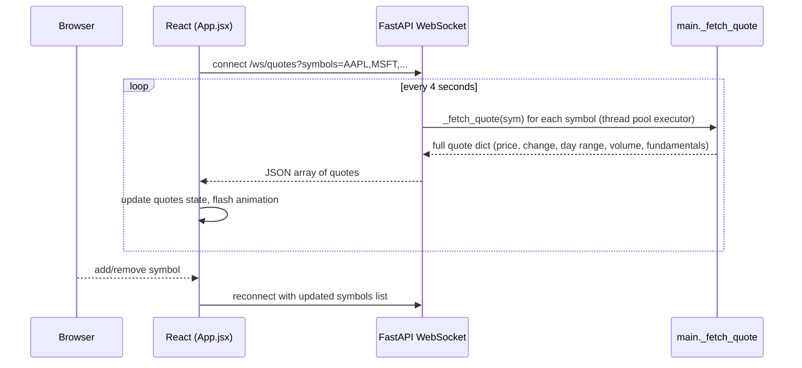

`routers/websocket_quotes.py` runs the blocking `_fetch_quote` calls in a thread-pool executor per tick so the async event loop isn't blocked; each quote itself is cached the normal way (`quote:{symbol}`, part of `_MARKET_TTL`), so a busy watchlist doesn't re-fetch from Yahoo every 4 seconds for symbols other tabs already warmed.

## Data Flow — Daily / Weekly Digest

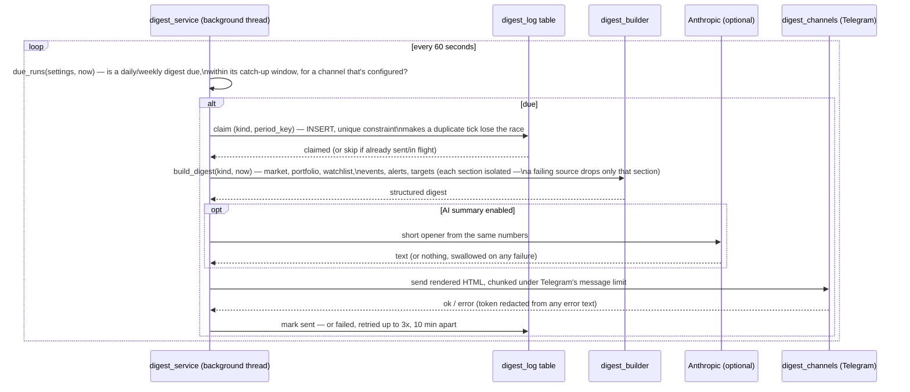

Started by `main.py`'s `lifespan` on startup (`DIGEST_SCHEDULER=0` disables it) and stopped on shutdown. A `POST /api/digest/send` (manual, from the Digests tab) reuses the same `run_digest()` path with a trigger of `"manual"` instead of `"scheduled"`, and manual runs are never deduped against each other.

## Data Flow — Range Screener

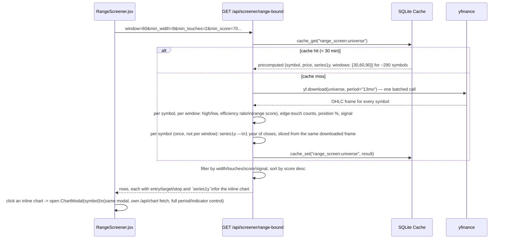

An optional `symbols=` query param bypasses the cached universe and scans a caller-supplied list instead — not cached, since arbitrary combinations aren't worth persisting. `series1y` is fetched once per symbol (not once per scan window, which would triple it for identical underlying data) in the *same* batched call the scan windows already need — the 13-month lookback covers both. The inline chart's y-scale is the 1-year series' own min/max, with the selected window's low/high drawn as reference lines wherever they actually fall inside it — so a look at the chart shows the current range in the context of the whole year's swings, not just the window in isolation. Clicking it opens the same `ChartModal` other tables use (`IndexHeatmap.jsx`, `MarketSummary.jsx`, `PortfolioTracker.jsx`, …): a self-contained modal with its own `/api/chart/{symbol}?period=...` fetch, independent of the range screener's own data.

## Data Flow — Index / ETF Heatmap

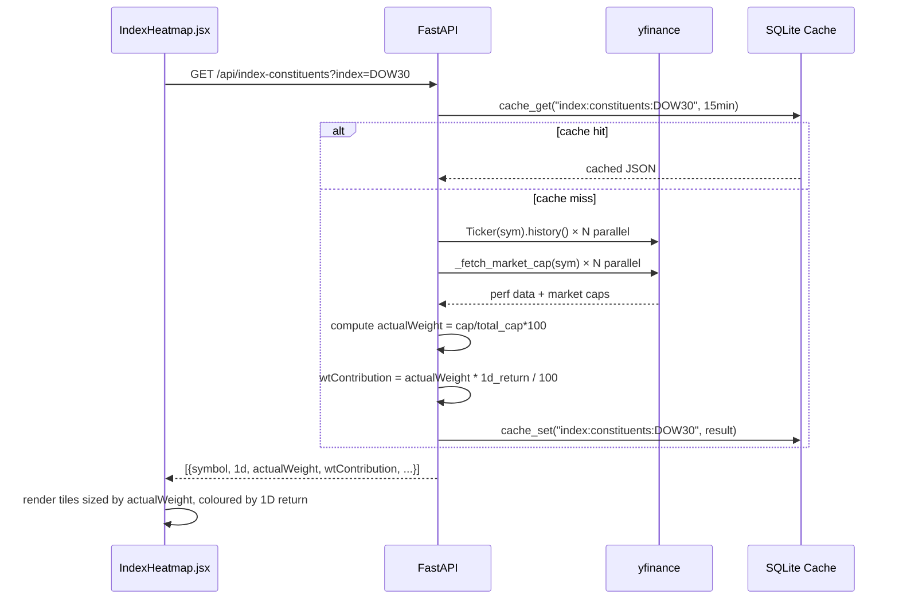

## Data Flow — Company Tear Sheet

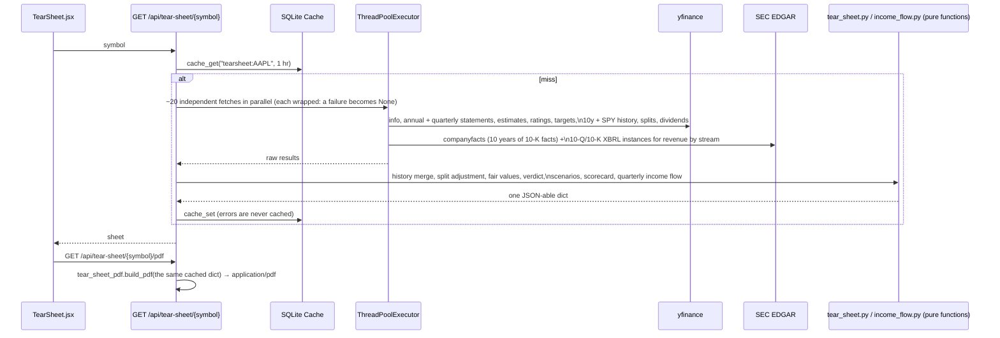

**Design notes**

- *One endpoint, many sources, tolerant of any of them failing.* `_fetch_raw` runs every independent fetch in a thread pool and wraps each in `_safe`, so a missing statement or a failed SEC call blanks one section instead of the whole sheet. The assembly in `_build_tear_sheet` is pure (no I/O), which is how it is unit-tested with hand-built frames.
- *10-year history from SEC filings.* Yahoo serves ~4 fiscal years; EDGAR's XBRL `companyfacts` goes back much further. Only full-year 10-K facts are used (the feed mixes quarterly and year-to-date durations under one tag), the latest-filed value wins when a year was restated, and tags that changed over the years are stitched in priority order. EPS and share counts are split-adjusted using the splits after each filing date. Yahoo fills any field EDGAR didn't tag and supplies balance-sheet items; non-SEC filers fall back to Yahoo alone.
- *Valuation verdict.* The median of up to four independent models (historical P/E, PEG = 1, a 10-year FCF DCF, the discounted analyst target), requiring at least two. Foreign ADRs whose statements are in a different currency than the share price skip the per-share models, and banks blank free cash flow, rather than produce a confident wrong answer.
- *Quarterly income flow.* `sec_revenue_streams.py` reads the 10-Q/10-K XBRL for revenue by product / segment / region and keeps only a set of members that adds up to reported revenue (members overlap, so summing all would double count); Q4 is derived as the fiscal year minus nine months. `income_flow.py` builds the revenue → profit → dividends graph with every node conserving what flows in and out, and **lays it out in the backend** (node rectangles, Bézier link paths) so the web page and the PDF draw identical diagrams from one source of truth.

## Data Flow — Holdings Performance

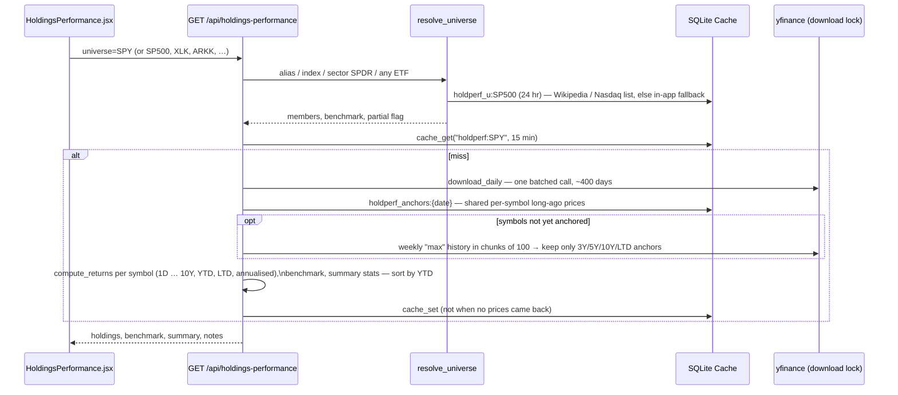

Why it is shaped this way: 3Y–LTD returns need decades of history for ~500 stocks, so those come from weekly bars in small chunks (a single 500-stock request holds ~150 MB) from which only a few anchor prices per symbol are kept; anchors live in **one shared per-symbol store** so the S&P 500, SPY and a sector ETF reuse each other's downloads. `yfinance.download` is not thread-safe, so every call goes through one lock, and a partial anchor result (rate limiting, a failed chunk) is used for the request but not cached.

## Data Flow — Economy & Sectors

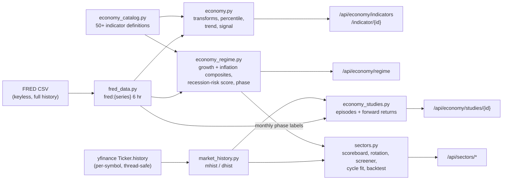

Design notes:

- *Two data sources, deliberately separate.* FRED holds the macro series; Yahoo holds prices. Per-symbol `Ticker.history` calls are independent and run in a small thread pool, unlike the batched `yf.download` (not thread-safe, guarded by the Holdings Performance lock).
- *Everything is a pure function.* `economy*.py` and `sectors.py` take Series and return dicts, so the tests build synthetic economies and markets with known answers (a recession at known months, a sector that trends harder than the rest) and assert the labels, scores and returns that must follow. Routers only fetch, call and cache.
- *No look-ahead.* Growth and inflation percentiles are expanding-window (a month is ranked only against the past), studies delay entry by the data's publication lag, and the backtest scores each month-end using only data up to that date (tested by corrupting future prices and asserting the scores do not change).
- *Calibrated, then disclosed.* The recession phase threshold (55) was chosen by checking the score against NBER dates since 1990: Sahm and CFNAI were tried as stand-alone overrides and produced false alarms (1992, 2002, 2010, 2021, 2024), so they contribute only through the composite. The page shows the score's record around each recession.
- *Honest samples.* Studies count independent episodes (runs of the condition, merged within six months) instead of months, and flag fewer than four as anecdotal; the sector figures begin in 1999 and say so.

## Data Flow — Themes

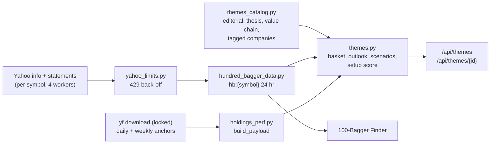

Design notes:

- *One fetch, two features.* The 100-Bagger Finder and the Themes pages share the per-symbol Yahoo fetch (`hb:{symbol}`), so scanning one warms the other. A single background scan covers every company in every theme; any theme page just polls its progress.
- *Prices reuse the Holdings Performance engine.* All themes' tickers (plus SPY and the ETFs) go through one `build_payload` call, so 3Y/5Y returns come from the shared anchor cache; only the baskets and members are assembled per theme.
- *Editorial and live data are kept apart.* The catalog carries framing and classification (role, exposure, layer); it has no numbers, and a test enforces that. The setup score is computed from live data plus the catalog's exposure rating, with a risk haircut and label cap so unprofitable, deeply fallen or very small names cannot rank as strong setups.
- *Scenario themes carry an `impact` block and an `atrisk` role.* AI Abundance adds hand-written jobs / markets / winners / scenarios content, rendered as tabs, and companies a theme could undercut. Those are displayed with live data but excluded from the basket, outlook, series, setup ranking and candidates (tested), so a disrupted business never reads as a recommendation.
- *Funds and per-theme labels.* Catalog entries have a `kind` (stock or fund) and a theme can relabel the generic roles. Funds (the Dollar Regime Shift theme is mostly funds) are priced but never fetched for fundamentals, get no setup score, and are excluded from rankings and candidates; the editorial `impact` block is a list of typed sections (lists, cards, ranked, scenarios) rendered generically, so a theme chooses its own tabs.
- *Polling can't re-download prices.* A partial result (fundamentals still loading) is cached for two minutes (`themes:partial`) so the page's polling reuses it instead of re-downloading ~140 price histories, which is what used to trip Yahoo's rate limit.
- *Degrades instead of failing.* If Yahoo refuses fundamentals, the pages render prices and performance with a note and retry after the cooldown; a partial result is never cached.

## Data Flow — AI Streaming (Chat / Trade Ideas / Morning Briefing / Advisor)

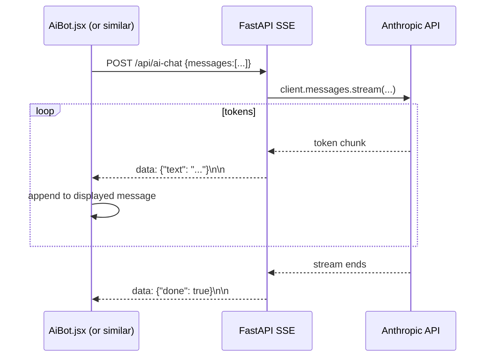

## Component Map (by Navigation Group)

101 sidebar views in 13 groups, plus Home and Help, backed by ~110 component files (`frontend/src/components/`). Every view is loaded with `React.lazy` in `App.jsx`, so each one is its own on-demand chunk and the landing page stays small; `App.jsx` is also the authoritative nav structure (`NAV_GROUPS`). Representative components per group:

```
Home
├── HomeDashboard.jsx          Aggregated P&L, market pulse, movers, earnings, alerts, "What's New"
└── CommandPalette.jsx         ⌘K fuzzy search across every view

Markets  (11 views)
├── MarketSummary.jsx          Overview: indices, sectors, Mag7, movers, news
├── IndexHeatmap.jsx           Constituent heatmap with dynamic ETF search
├── HoldingsPerformance.jsx    Per-holding returns over 1D…10Y/LTD, ranked by YTD
└── RedditTrending, ShortSqueeze, IpoCalendar, InsiderFeed, CryptoDashboard, MarketSentimentDashboard …

Economy  (6)
├── EconomyRegime.jsx          Cycle phase, growth × inflation quadrant, recession-risk score + track record
├── EconomyIndicators.jsx      50+ indicators, filters, detail panel (history chart with recession shading)
├── IndicatorStudies.jsx       What stocks did after a macro condition began, by episode
├── YieldCurve.jsx, FedWatch.jsx, MacroCalendar.jsx
└── MacroKit.jsx               Shared: useApi hook, formatters, TimeChart (SVG, recession bands, hover), Sparkline

Themes  (6)
├── ThemesOverview.jsx         Cards, side-by-side returns, leaders and laggards
├── ThemePage.jsx              One data-driven page per theme: basket vs SPY, outlook, scenarios, value chain, company table, candidates
└── ThemeKit.jsx               Shared return cells, setup pill, scan progress, partial-data note

Sectors  (5)
├── SectorScoreboard.jsx       11 SPDR sectors × 11 periods, risk view, calendar years, drill-down to holdings
├── SectorRotation.jsx         Relative-rotation graph with trails
├── SectorScreener.jsx         Horizon screener with adjustable factor weights and explanations
└── SectorCycleFit.jsx, SectorBacktest.jsx

Watchlist  (7)
├── StockTable.jsx             Live watchlist with flash animations
├── RichEarningsCalendar.jsx   Earnings+ (expected move, beat rate, drift)
├── SmartAlerts.jsx            Condition scanner (volume, RSI, crossovers)
└── WatchlistHeatmap, CorrelationMatrix, PriceTargets, NewsSentiment …

News  (1)         CustomNews.jsx — multi-ticker news feed

Research  (22)
├── TearSheet.jsx              Company snapshot, valuation verdict, quarterly income flow (Sankey), PDF
├── HundredBaggers.jsx         100-bagger trait screen (background scan + progress, factor breakdown)
├── PriceProjection.jsx        1-year price cone from options, rates, VIX and credit
├── Screener.jsx, RangeScreener.jsx, TechnicalSignals.jsx
├── Backtester.jsx, DcfCalculator.jsx, FundamentalComparison.jsx, StockComparison.jsx
└── Bonds (corporate / convertible / treasury), FundHoldingsExplorer, EtfOverlapAnalyzer,
    ActivistTracker, RelativeStrengthRanker, SeasonalPatterns, earnings & analyst trackers …

Trading  (4)
├── DayTrader.jsx              Trading plan + playbooks + intraday scanner
├── TradeIdeas.jsx, PositionSizer.jsx
└── WheelTracker.jsx           Cash-secured put / covered call cycle

Merger Arb  (7)   MergerArbOverview, MergerDealDashboard, MergerOpportunityScanner,
                  MergerDealAnalyzer, MergerArbPortfolio, MergerRiskMatrix, MergerAlerts
SPACs       (7)   SpacOverview, SpacTracker, SpacDiscovery, SpacDealAnalyzer,
                  SpacPortfolio, SpacRiskMatrix, SpacAlerts
                  (cross-tab drill-in: App.jsx lifts mergerFocusDealId / spacFocusId)

Portfolio  (9)
├── PortfolioTracker.jsx       11 internal views: heatmap, table, equity curve, risk, optimizer, X-ray, …
├── OptionsTracker.jsx, TradeJournal.jsx, DividendTracker.jsx, TaxLotManager.jsx
└── PortfolioStressTest, PortfolioAttribution, CppiAllocator, NetExposure

AI Tools  (7)
├── AiBot.jsx                  Streaming chat (SSE)
├── MorningBriefing.jsx        AI pre-market briefing (SSE)
├── DigestCenter.jsx           Daily/weekly digest settings, preview, send, history
└── FinancialAdvisor, StockAnalyzer, PortfolioReview, TaxAdvisor

Retirement  (8)   FireCalculator, CoastFire, MonteCarlo, SocialSecurity,
                  EarlyRetirementHealth, RothConversionPlanner, MedicareEstimator, EstateRmdProjector

Help
├── UserGuide.jsx                In-app documentation (+ changelog); tests check that every sidebar
│                                view is described and every changelog link targets a real tab
└── InvestorEducation.jsx        Layered map of investing concepts, with live data snapshots
                                  and deep links to matching tools

Shared
├── ChartModal.jsx               11-tab overlay (chart, fundamentals, news, earnings, options,
│                                strategies, insider, analyst, institutional, sentiment, SEC filings)
├── data/changelog.js            Changelog entries — single source for the guide and Home "What's New"
└── utils/format.js              Shared formatters
```

## Caching Architecture

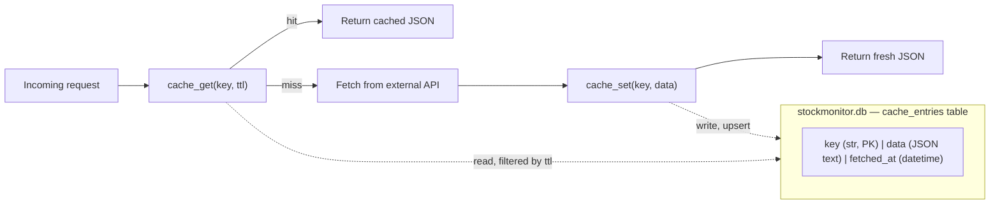

`cache_get(key, ttl)` and `cache_set(key, data)` in `database.py` are the only way any router touches the cache — a plain key/value table with the freshness window passed in by the caller at read time, not stored per row.

Every key and TTL below was extracted from the code (`grep cache_get`), so it is complete as of this writing. Many routers build the key in a variable first; the patterns are shown as written.

| Cache key | TTL | Module → data |
|---|---|---|
| `quote:{sym}` | 15 min | `main.py` → live quote (price, change, day range, fundamentals). Also read by `custom_screener` (10 min) and `range_screener` (6 hr) |
| `fund:{sym}` | 5 min | `main.py` → fundamentals (P/E, EPS, beta, …) |
| `perf:main`, `market:summary` | 15 min | `main.py` → market performance; Overview page |
| `chart:{symbol}:{period}` | 1 min (1d) · 5 min (5d) · 30 min (1mo, 3mo) · 1 hr (6mo) · 4 hr (1y, 2y) · 24 hr (5y) | `routers/chart.py` → OHLCV bars |
| `news:{symbol}` | 5 min | `routers/news.py` → headlines |
| `market:rates` | 30 min | `routers/yield_curve.py` → Treasury yields + DXY |
| `treasury_current`, `treasury_history:…`, `treasury_yield_curve` | 6 hr | `routers/treasury.py` → Treasury.gov par yields; `treasury_csv:{year}` is 6 hr for the current year, 30 days for past years |
| `market:breadth`, `market:fed-watch`, `mkt_sentiment_v1`, `market:short-squeeze`, `reddit_trending_{source}_{limit}` | 30 min | one per Markets view of the same name |
| `index:constituents:{index}`, `etf:holdings:{etf}` | 15 min | `routers/index_constituents.py` |
| `themes:partial` | 2 min | `routers/themes.py` → the assembled result while fundamentals are still loading (reused by polling; never replaces `themes:built`) |
| `themes:built` | 15 min | `routers/themes.py` → all four themes assembled (prices, baskets, members); not cached when fundamentals are partial |
| `hb:{symbol}` · `hb_u:{id}` | 24 hr | `hundred_bagger_data.py` → Yahoo fundamentals and statements for one symbol (failures are not cached); S&P 600/400 membership |
| `fred:{series}` | 6 hr | `fred_data.py` → one FRED series as {dates, values} |
| `economy:catalog`, `economy:regime` | 30 min | `routers/economy.py` → indicator table; regime dashboard |
| `economy:detail:{id}` | 30 min | `routers/economy.py` → one indicator's history |
| `economy:study:{id}` | 6 hr | `routers/economy.py` → one indicator study |
| `mhist:{symbol}` · `dhist:{symbol}` | 24 hr · 6 hr | `market_history.py` → full monthly / daily adjusted-close history |
| `sectors:scoreboard`, `sectors:rotation` | 30 min | `routers/sectors.py` |
| `sectors:cyclefit:{group}`, `sectors:backtest:{n}:{cost}:{def}` | 6 hr | `routers/sectors.py` |
| `holdperf:{id}` | 15 min | `holdings_perf.py` → assembled holdings-performance table for one index/ETF |
| `holdperf_anchors:{date}` | 26 hr | `holdings_perf.py` → shared per-symbol long-ago prices (3Y/5Y/10Y/LTD), reused by every universe |
| `holdperf_u:{id}` | 24 hr | `holdings_perf.py` → index membership (Wikipedia / Nasdaq, or the in-app fallback) |
| `market:crypto`, `market:premarket`, `day_trader:scanners`, `day_trader:news`, `wlheat:{sym}` | 5 min | crypto, pre-market movers, Day Trader, Watchlist heatmap |
| `market:ipo-calendar:v2`, `market:ipo-pipeline` | 1 hr | `routers/ipo_lockup_calendar.py` → live from EDGAR |
| `market:insider-feed:{days}` | 4 hr | `routers/insider_trading_feed.py` |
| `earnings:{sym}` | 4 hr | `routers/earnings_calendar.py` → upcoming dates + EPS estimates |
| `rich_earn:{symbol}` | 2 hr | `routers/rich_earnings_calendar.py` → expected move, beat rate, pre-earnings drift |
| `earnings:history:{symbol}` | 6 hr | `routers/earnings_history.py` → 8 quarters EPS/revenue |
| `earnings:play:{sym}`, `earnstrat:{sym}`, `earnsurp:{sym}` | 4 hr · 6 hr · 12 hr | earnings play calculator, strategy analyzer, surprise tracker |
| `analyst:{sym}`, `analyst_tracker:{sym}` | 6 hr | `routers/analyst_ratings.py`, `analyst_rating_tracker.py` (separate keys on purpose — they once collided) |
| `analyst_hist:{symbol}` | 10 min | `routers/analyst_history.py` |
| `insider:{sym}`, `institutional:{symbol}`, `filings:{symbol}` | 4 hr · 4 hr · 12 hr | Chart-modal Insider, Institutional and SEC Filings tabs |
| `div:{sym}`, `dividends:{…}` | 6 hr · 4 hr | `routers/dividend_tracker.py`, `routers/dividends.py` |
| `options:exps:{sym}`, `options:chain:{sym}:{expiry}` | 15 min | `routers/options_chain.py` |
| `uoa:{sym}`, `uoa:{symbols}` | 10 min · 30 min | `routers/unusual_options.py` |
| `strategies:{symbol}:{view}`, `sentiment:{symbol}`, `snapshot:{symbol}` | 1 hr · 1 hr · 15 min | AI options strategies, per-symbol AI sentiment, Stock Analyzer snapshot |
| `news_sentiment:{symbols}` | 2 hr | `routers/news_sentiment_engine.py` |
| `ai:analyst`, `ai:stocks` | 15 min | `routers/ai_analyst_actions.py`, `ai_stocks.py` |
| `transcript:{sym}` | 24 hr | `routers/earnings_call_summarizer.py` |
| `fundc:{symbol}`, `dcf_prefill:{sym}` | 2 hr | fundamentals comparison, DCF pre-fill |
| `priceproj:{sym}` | 2 hr | `routers/price_projection.py` |
| `screener:tech:{scan}`, `screener:fund:{screen}` | 20 min | `routers/screener.py` |
| `signals:{symbol}`, `rs:{symbols}`, `seasonal:{sym}:{years}`, `etfhold:{sym}`, `etfoverlap:{…}` | 30 min · 30 min · 24 hr · 24 hr · 24 hr | signals, relative strength, seasonality, ETF overlap |
| `range_screen:universe` | 30 min | `routers/range_screener.py` → ~290-symbol universe |
| `corr:{symbols}:{period}` | 30 min (portfolio) · 1 hr (market) | `correlation_matrix.py`, `market_correlation.py` |
| `portfolio:risk`, `portfolio:frontier` | 30 min | risk dashboard, efficient frontier |
| `portfolio:xray` | 1 hr | `routers/portfolio_xray.py` |
| `portfolio:net-exposure`, `home:summary` | 2 min | net exposure, Home dashboard |
| `merger_edgar_scan`, `merger_opportunities_scan`, `spac_discovery_scan` | 4 hr | Merger Arb / SPAC EDGAR scans |
| `activist_tracker_{days}` | 4 hr | `routers/activist_tracker.py` |
| `edgar_search:{q}`, `edgar_holdings2:{cik}:{n}` | 12 hr · 6 hr | `routers/fund_holdings.py` |
| `mf_ticker_map`, `bond_fund:{t}`, `bond_search:{q}`, `bond_ratings_mentions:{t}`, `convert_xbrl:{cik}`, `convert_search:{q}` | 7 days · 24 hr · 6 hr · 24 hr · 24 hr · 6 hr | bond and convertible-bond research |
| `sec_ticker_name_map` | 24 hr | `edgar_utils.py` → SEC name → ticker map |
| `tearsheet:{sym}` | 1 hr | `routers/tear_sheet.py` → assembled tear sheet (errors are not cached) |
| `tearsheet_edgar:{sym}` | 24 hr | `routers/tear_sheet.py` → parsed 10-year annual history from SEC `companyfacts` |
| `sec_rev_rows:{cik}:{accession}`, `sec_rev_labels:{cik}:{accession}` | 30 days | `sec_revenue_streams.py` → parsed revenue-by-dimension facts and member labels for one filing (filings never change) |

## Key Backend Patterns

**Parallel fetching with ThreadPoolExecutor**
```python
with ThreadPoolExecutor(max_workers=20) as ex:
    futures = {ex.submit(_fetch_perf_one, sym): sym for sym in symbols}
    for f in as_completed(futures):
        results[futures[f]] = f.result()
```
Used throughout — index constituent perf, market performance, technical signals, the digest builder's per-symbol price lookups, the range screener's earnings-date lookups.

**Function-scoped deferred imports** (see "Why the core is small" above)
```python
@router.get("/api/some-feature")
def some_endpoint():
    from main import _fetch_perf_one   # resolved at call time, not module load
    ...
```

**WebSocket price broadcaster**
```python
@router.websocket("/ws/quotes")
async def ws_quotes(websocket: WebSocket, symbols: str = ""):
    from main import _fetch_quote
    await websocket.accept()
    loop = asyncio.get_event_loop()
    while True:
        results = await loop.run_in_executor(None, lambda: [_fetch_quote(s) for s in syms])
        await websocket.send_json(results)
        await asyncio.sleep(4)
```

**SSE streaming for AI endpoints**
```python
def generate():
    with anthropic_client.messages.stream(...) as stream:
        for text in stream.text_stream:
            yield f"data: {json.dumps({'text': text})}\n\n"
    yield f"data: {json.dumps({'done': True})}\n\n"

return StreamingResponse(generate(), media_type="text/event-stream")
```

**Background scheduler + at-most-once claiming** (digests)
A daemon thread started by `main.py`'s FastAPI `lifespan` ticks every 60 seconds, checking whether a daily or weekly digest is due (and still within a catch-up window, for a machine that was asleep at the scheduled time). Before doing any work it claims `(kind, period_key)` — e.g. `("daily", "2026-09-23")` or `("weekly", "2026-W39")` — as a row in `digest_log`, whose unique constraint makes a duplicate tick (or a second process) lose the race and skip. A failed delivery retries up to 3 times, 10 minutes apart.

**Test database isolation**
`backend/tests/conftest.py`'s autouse `isolated_db` fixture points `database.SessionLocal` at a throwaway SQLite database for the duration of each test, so the test suite never reads or writes `backend/stockmonitor.db`. This works for every router with no per-router change, because `db_session()`/`cache_get()`/`cache_set()` in `database.py` resolve `SessionLocal` by module-level name at call time rather than capturing it at import time.

**Serialise `yfinance.download`**
`yfinance.download` stores its working state in module-level dictionaries, so two downloads in flight at once — even from different threads — corrupt each other and hang. `holdings_perf.py` wraps every call in one `threading.Lock`; per-symbol `Ticker(...).history()` calls from a thread pool are independent and safe. Any new batched download should take the same lock.

**Degrade, don't fail (best-effort enrichment)**
Optional data is layered on a reliable core and blanked quietly when it can't be trusted. The Tear Sheet runs ~20 fetches in parallel with each wrapped in `_safe` (failure → `None`); SEC revenue-by-stream data is kept only when its members reconcile to reported revenue (tolerance 0.3% — looser let double-counting partitions through); foreign ADRs reporting in another currency skip per-share models; banks blank free cash flow; a partial long-history download is used for the request but never cached. The UI shows an explanatory note instead of a wrong number.

**Pure core, injected I/O**
Features with real logic are split into a pure computation module and a thin router — `holdings_perf.py`, `income_flow.py`, `sec_revenue_streams.py`, `tear_sheet.py`'s `_build_tear_sheet`. Network calls (`yf.download`, SEC requests, Wikipedia) sit behind small functions that tests replace, so the maths is verified against hand-computed numbers and the failure modes (a failed chunk, a restated year, an unreconcilable segment set) are reproduced deterministically.

**Compute layout once, draw twice**
The quarterly income Sankey is laid out in the backend (`income_flow.layout_sankey` returns node rectangles and Bézier link paths in a fixed 1000×420 space). `TearSheet.jsx` renders it as SVG and `tear_sheet_pdf.py` as reportlab vector graphics, so the page and the PDF cannot drift apart, and the layout (bounds, overlap, label spacing, proportionality) is unit-tested in Python.

## Testing

| Suite | Size | Notes |
|---|---|---|
| Backend (pytest) | 907 tests, ~10 s | `backend/tests/`: digest, main, price projection, range screener, tear sheet, tear sheet PDF, income flow, SEC revenue streams, holdings performance, economy indicators/regime/studies, sectors. No network; every test runs against a throwaway SQLite database (see "Test database isolation"). |
| Frontend (Vitest + Testing Library) | 284 tests | Component tests next to the components. `UserGuide.test.jsx` also enforces **documentation integrity**: every sidebar view must appear in the guide, and every changelog "Open feature" link must target a route `App.jsx` can render. |
| Lint gate | `ruff check --select F` | Pre-commit hook on staged backend files — catches undefined names left behind by refactors on code paths tests don't exercise. |

Run with `python -m pytest` in `backend/` and `npm test` in `frontend/`.

## Deployment

One process serves everything: `uvicorn main:app` serves the API, the WebSocket and — via the SPA catch-all registered last — the built frontend from `frontend/dist`. `render.yaml` describes a Render web service (build: `npm install && npm run build` in `frontend/`, then `pip install -r requirements.txt`; start: `uvicorn main:app`). SQLite lives beside the code, the digest scheduler is a thread in the same process (so run a single worker), and there is no authentication — the app is built for one user on a trusted machine, not for the open internet.
